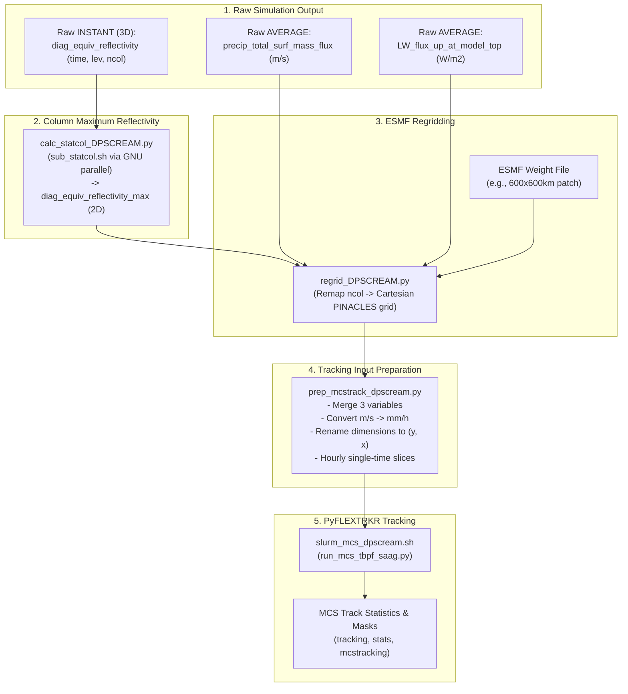

# DP-SCREAM to PyFLEXTRKR MCS Tracking Workflow

This document outlines the end-to-end data processing workflow for converting raw DP-SCREAM model outputs into single-timestep Cartesian NetCDF files required by the [PyFLEXTRKR](https://github.com/FlexID/PyFLEXTRKR) Mesoscale Convective System (MCS) tracking package.

---

## 1. Workflow Architecture

The pipeline consists of five key stages: raw model output extraction, column-maximum reflectivity calculation, horizontal remapping, tracking file preparation, and PyFLEXTRKR tracking execution.



> [!NOTE]
> **Why input files are not concatenated into daily files:**  
> PyFLEXTRKR parallelizes feature identification and tracking across individual input files. Maintaining granular, hourly input files keeps all parallel compute cores fully utilized (e.g. across 128 CPU tasks on a compute node), whereas daily multi-timestep files would limit parallelism and slow tracking execution.

---

## 2. Variables and Units Reference

PyFLEXTRKR tracks Cold Cloud Systems (CCS) using brightness temperature derived from Outgoing Longwave Radiation (OLR) and collocated Precipitation Features (PF).

| PyFLEXTRKR Variable | DP-SCREAM Variable | Simulation Stream / Origin | Input Unit | Final Tracking Unit | Description |
| :--- | :--- | :--- | :--- | :--- | :--- |
| `rain_rate` | `precip_total_surf_mass_flux` | Raw `AVERAGE` (`nhours_x1`) | `m/s` | `mm/h` | Surface precipitation mass flux |
| `toa_lw_up` | `LW_flux_up_at_model_top` | Raw `AVERAGE` (`nhours_x1`) | `W/m2` | `W/m2` | Upward longwave flux at TOA (converted to $T_b$ internally) |
| `ref` | `diag_equiv_reflectivity_max` | Derived 2D from 3D `diag_equiv_reflectivity` (`INSTANT`) | `dBZ` | `dBZ` | Column-maximum equivalent radar reflectivity |

> [!IMPORTANT]
> **Precipitation Unit Conversion:**  
> DP-SCREAM outputs `precip_total_surf_mass_flux` in `m/s` ($1\text{ m/s} = 1000\text{ kg/m}^2\text{s}$). PyFLEXTRKR expects precipitation in `mm/h`.  
> The conversion factor is $1000\text{ mm/m} \times 3600\text{ s/h} = 3,600,000$. This conversion is handled in [prep_mcstrack_dpscream.py](file:///global/cfs/cdirs/wcm_code/ksa/DP-SCREAM/mcs/prep_mcstrack_dpscream.py).

---

## 3. Step-by-Step Processing Pipeline

### Step 1: Raw Simulation Output
- **Location:** `/pscratch/sd/k/ksa/simulation/DP-SCREAM/cases/{icase}/run` (or shared scratch `/pscratch/sd/w/wcmca1/DP-SCREAM/{icase}/run`)
- **Structure:** Files on the native unstructured DP-SCREAM horizontal mesh with dimension `ncol`.
- **Files needed:**
  - `{icase}.hist.AVERAGE.nhours_x1.{YYYY-MM-DD-sssss}.nc` (containing 2D `precip_total_surf_mass_flux` and `LW_flux_up_at_model_top`)
  - `{icase}.hist.INSTANT.nhours_x1.{YYYY-MM-DD-sssss}.nc` (containing 3D `diag_equiv_reflectivity` on `(time, lev, ncol)`)

---

### Step 2: Column-Maximum Reflectivity Calculation
- **Scripts:**
  - Slurm batch driver: [`sub_statcol.sh`](file:///global/cfs/cdirs/wcm_code/ksa/DP-SCREAM/batch/sub_statcol.sh)
  - Wrapper script: [`run_py_statcol.sh`](file:///global/cfs/cdirs/wcm_code/ksa/DP-SCREAM/python_DP-SCREAM/run_py_statcol.sh)
  - Python calculation: [`calc_statcol_DPSCREAM.py`](file:///global/cfs/cdirs/wcm_code/ksa/DP-SCREAM/python_DP-SCREAM/calc_statcol_DPSCREAM.py)
- **Purpose:** `diag_equiv_reflectivity_max` is not a direct model output. DP-SCREAM outputs full 3D radar reflectivity `diag_equiv_reflectivity(time, lev, ncol)`. This step computes the column-maximum value along the vertical dimension (`lev` axis) for each horizontal column (`ncol`).
- **Execution Workflow:**
  1. [`sub_statcol.sh`](file:///global/cfs/cdirs/wcm_code/ksa/DP-SCREAM/batch/sub_statcol.sh) constructs an argument list (`inputfile`) iterating through all instantaneous output files for the specified date range.
  2. The job uses GNU `parallel` to run [`run_py_statcol.sh`](file:///global/cfs/cdirs/wcm_code/ksa/DP-SCREAM/python_DP-SCREAM/run_py_statcol.sh) across multiple worker threads:
     ```bash
     sbatch batch/sub_statcol.sh
     ```
  3. Under the hood, each task calls:
     ```bash
     python calc_statcol_DPSCREAM.py \
         --varname diag_equiv_reflectivity \
         --colstat_type max \
         --icase ${icase} \
         --infile ${raw_instant_file} \
         --ifreq nhours_x1
     ```
- **Output:**
  - Saved to: `/pscratch/sd/w/wcmca1/DP-SCREAM/{icase}/cat_raw/`
  - Filename: `{icase}.diag_equiv_reflectivity_max.INSTANT.nhours_x1.{YYYY-MM-DD-sssss}.nc`
  - Contains 2D field `diag_equiv_reflectivity_max(time, ncol)`.

---

### Step 3: Horizontal Regridding (ESMF Offline Remapping)
- **Script:** [`regrid_DPSCREAM.py`](file:///global/cfs/cdirs/wcm_code/ksa/DP-SCREAM/python_DP-SCREAM/regrid_DPSCREAM.py)
- **Purpose:** Remaps unstructured `ncol` data to a uniform Cartesian grid (e.g., $600 \times 600\text{ km}$ at $1\text{ km}$ resolution, named `PINACLES_YX_dx1km_600x600km`).
- **Method:**
  - Loads sparse matrix weights generated via ESMF (`patch` or `conservative` method) from `/global/cfs/cdirs/wcm_shr/DP-SCREAM/remap/`.
  - Performs sparse matrix-vector multiplication $W \cdot D$ to project onto dimensions `(time, lat, lon)`.
  - Generates auxiliary spatial coordinate variables `x` and `y` in meters.
- **Execution:** Run the script for each of the three variables:
  ```python
  # Run 1: Precipitation (reads raw AVERAGE files directly from run dir)
  varname = "precip_total_surf_mass_flux"
  stats_type = "AVERAGE"
  file_type = "raw"

  # Run 2: OLR (reads raw AVERAGE files directly from run dir)
  varname = "LW_flux_up_at_model_top"
  stats_type = "AVERAGE"
  file_type = "raw"

  # Run 3: Radar Reflectivity (reads 2D column-max from Step 2 in cat_raw)
  varname = "diag_equiv_reflectivity_max"
  stats_type = "INSTANT"
  file_type = "proc"
  ```
- **Output Directory:** `/pscratch/sd/w/wcmca1/DP-SCREAM/{icase}/remapped/`
- **Output Files:** `{icase}.{varname}.{stats_type}.{frequency}.{dstgrid}.{YYYY-MM-DD}.nc`

---

### Step 4: Tracking Input Preparation
- **Script:** [`prep_mcstrack_dpscream.py`](file:///global/cfs/cdirs/wcm_code/ksa/DP-SCREAM/mcs/prep_mcstrack_dpscream.py)
- **Purpose:** Combines the three regridded variables into single-time NetCDF files formatted to match the PINACLES / PyFLEXTRKR data specification.
- **Operations Performed:**
  1. **Dataset Merging:** Matches time slices for `rain_rate`, `toa_lw_up`, and `ref` for each day.
  2. **Timestamp Alignment:** Uses timestamps from the `INSTANT` reflectivity file so filenames correspond to the end of the 1-hour averaging window (e.g., `0100` rather than `0000`).
  3. **Unit Conversion:** Checks if `rain_rate` (`precip_total_surf_mass_flux`) is in `m/s`; if so, multiplies by $3.6 \times 10^6$ to convert to `mm/h` and updates metadata.
  4. **Dimension Renaming:** Converts spatial dimensions from `('lat', 'lon')` to Cartesian `('y', 'x')`.
  5. **Coordinate Formatting:** Assigns 1D `x`, `y`, `lat`, `lon` coordinates and creates an unlimited scalar `time` coordinate (`hours since 2000-01-01 00:00:00`, `noleap`).
- **Execution:**
  ```bash
  module load python
  conda activate analysis_2026
  python mcs/prep_mcstrack_dpscream.py
  ```
- **Output Directory:** `/pscratch/sd/w/wcmca1/DP-SCREAM/{icase}/mcstrack/`
- **Output Files:** `{icase}.mcstrack.{YYYY-MM-DD_HHMM}.nc` (e.g., `RCE02_dx1km_gpu.mcstrack.2000-01-01_0100.nc`)

---

### Step 5: Running PyFLEXTRKR MCS Tracking
- **Configuration File:** [`config_ccs_olr_DPSCREAM.yml`](file:///global/cfs/cdirs/wcm_code/ksa/DP-SCREAM/mcs/config/config_ccs_olr_DPSCREAM.yml)
- **Slurm Batch Script:** [`slurm_mcs_dpscream.sh`](file:///global/cfs/cdirs/wcm_code/ksa/DP-SCREAM/mcs/slurm/slurm_mcs_dpscream.sh)
- **Key Configuration Settings:**
  - `clouddata_path`: Points to `/pscratch/sd/w/wcmca1/DP-SCREAM/{icase}/mcstrack/`
  - `olr2tb: True`: Converts `toa_lw_up` ($W/m^2$) to $T_b$ ($K$) via the Stefan-Boltzmann relation.
  - `pcp_convert_factor: 1.0`: Set to 1.0 since `rain_rate` is already converted to `mm/h` in Step 4.
  - `pbc_direction: both`: Enables doubly-periodic boundary conditions across $x$ and $y$.
  - `growth_method: edt`: Euclidean distance transform for cloud core growth.
- **Submission:**
  ```bash
  cd mcs/slurm
  sbatch slurm_mcs_dpscream.sh
  ```
- **Tracking Outputs:** Generated in `root_path` (e.g. `/pscratch/sd/w/wcmca1/DP-SCREAM/{icase}/mcstrack_test/`):
  - `tracking/`: Intermediate cloud-id, track numbers, and link netCDF files.
  - `stats/`: Summary statistics files (`mcs_tracks_final_*.nc`).
  - `mcstracking/`: 2D pixel-level track mask files for visualization and compositing.

---

## 4. Verification and Troubleshooting Checklist

1. **Verify Units of Remapped & Prepared Files:**
   ```bash
   ncdump -h /pscratch/sd/w/wcmca1/DP-SCREAM/{icase}/mcstrack/{icase}.mcstrack.2000-01-01_0100.nc | grep -A 2 "rain_rate"
   ```
   Confirm `units = "mm/h"`.
2. **Missing Input Time Steps:**
   Ensure both `AVERAGE` and `INSTANT` runs generated matching timestamps. If missing time warning occurs in `prep_mcstrack_dpscream.py`, verify date ranges in `regrid_DPSCREAM.py` and `sub_statcol.sh`.
3. **Periodic Boundaries:**
   For DP-SCREAM idealized runs, ensure `pbc_direction: both` is active in `config_ccs_olr_DPSCREAM.yml` so systems crossing domain edges are tracked continuously.
